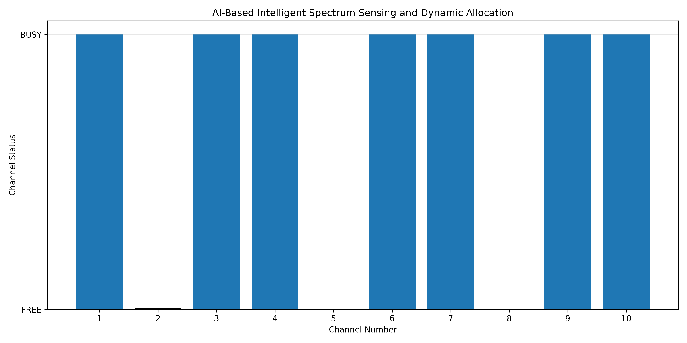

# AI-Driven Intelligent Spectrum Sensing and Dynamic Spectrum Allocation

An AI-based simulation system for intelligent spectrum sensing and
dynamic spectrum allocation in Cognitive Radio Networks using Machine
Learning, Signal Processing, MATLAB, Python, and a Web Dashboard.

------------------------------------------------------------------------

## 📌 Project Overview

Cognitive Radio enables wireless devices to intelligently utilize
available spectrum by detecting whether a channel is occupied or free.

Traditional Energy Detection is simple and widely used for spectrum
sensing, but its performance can be affected by noisy and low-SNR
environments.

This project investigates a Machine Learning-based approach using a
**Random Forest classifier** to classify spectrum channels as **FREE**
or **BUSY** and then perform **dynamic channel allocation**.

The project also compares the Machine Learning approach with
conventional Energy Detection and provides an integrated web-based
dashboard for visualization.

------------------------------------------------------------------------

## 🎯 Objectives

-   Implement traditional Energy Detection for spectrum sensing.
-   Generate and use a realistic spectrum sensing dataset.
-   Extract relevant signal features.
-   Train a Random Forest classifier for FREE/BUSY classification.
-   Evaluate ML performance under different SNR conditions.
-   Compare Random Forest with Traditional Energy Detection.
-   Implement dynamic spectrum channel allocation.
-   Develop an integrated web dashboard for system visualization.

------------------------------------------------------------------------

## 🏗️ System Architecture

``` text
Signal Generation
       ↓
Noise Addition
       ↓
Feature Extraction
       ↓
Random Forest Classifier
       ↓
FREE / BUSY
       ↓
Available Channels
       ↓
Dynamic Channel Allocation
       ↓
Web Dashboard
```

------------------------------------------------------------------------

## 🧠 Machine Learning Approach

The project uses a **Random Forest Classifier** for spectrum
classification.

### Features Used

1.  Energy
2.  Average Power
3.  Variance
4.  Peak Amplitude
5.  Spectral Peak Ratio

### Random Forest Configuration

``` text
Number of Trees       : 300
Maximum Depth         : 15
Minimum Samples Split : 4
Minimum Samples Leaf  : 2
Max Features          : sqrt
Class Weight          : balanced
Random State          : 42
```

------------------------------------------------------------------------

## 📊 Dataset

  Parameter                       Value
  ------------------ ------------------
  Training Samples                 6300
  Testing Samples                  2700
  Classes                   FREE / BUSY
  SNR Range            -20 dB to +20 dB
  SNR Step                         5 dB
  ML Features                         5

------------------------------------------------------------------------

## 📈 Performance

### Overall Random Forest Test Accuracy: **76.07%**

       SNR   Accuracy
  -------- ----------
    -20 dB     50.00%
    -15 dB     48.67%
    -10 dB     54.33%
     -5 dB     62.00%
      0 dB     81.00%
      5 dB     89.33%
     10 dB     94.00%
     15 dB     94.33%
     20 dB     93.00%

Classification performance improves substantially as SNR increases,
while low-SNR conditions remain challenging.

------------------------------------------------------------------------

## ⚖️ Traditional Energy Detection vs Random Forest

       SNR   Traditional ED   Random Forest
  -------- ---------------- ---------------
    -20 dB           49.00%          50.00%
    -15 dB           50.00%          48.67%
    -10 dB           54.50%          54.33%
     -5 dB           67.50%          62.00%
      0 dB           92.50%          81.00%
      5 dB           95.00%          89.33%
     10 dB           96.50%          94.00%
     15 dB           94.50%          94.33%
     20 dB           96.50%          93.00%

### Observation

The current Random Forest configuration does **not consistently
outperform Traditional Energy Detection** across all SNR conditions. The
ML system nevertheless provides a flexible framework for further
optimization and performs strongly at moderate and high SNR levels.

------------------------------------------------------------------------

## 📡 Dynamic Spectrum Allocation

After spectrum classification, the system identifies available channels
and automatically selects a FREE channel.

### Example Simulation

``` text
Channel 1  → BUSY
Channel 2  → FREE → ALLOCATED
Channel 3  → BUSY
Channel 4  → BUSY
Channel 5  → FREE
Channel 6  → BUSY
Channel 7  → BUSY
Channel 8  → FREE
Channel 9  → BUSY
Channel 10 → BUSY
```

``` text
Total Channels : 10
FREE Channels  : 3
BUSY Channels  : 7

Available Channels:
[2, 5, 8]

Selected Channel:
Channel 2

Allocation Status:
SUCCESS
```

------------------------------------------------------------------------

## 🖥️ Web Dashboard

The integrated web dashboard provides:

-   Signal and received/noisy signal visualization
-   Traditional Energy Detection results
-   Random Forest performance vs SNR
-   Traditional ED vs Random Forest comparison
-   Channel FREE/BUSY status
-   Dynamic channel allocation
-   Overall Random Forest accuracy

### Dashboard Flow

``` text
Signal
  ↓
Energy Detection
  ↓
Feature Extraction
  ↓
Random Forest
  ↓
FREE / BUSY
  ↓
Channel Selection
  ↓
Dynamic Allocation
  ↓
Web Dashboard
```

### Dashboard Screenshot



------------------------------------------------------------------------

## 🛠️ Technologies Used

-   Python
-   MATLAB
-   Scikit-learn
-   Random Forest
-   NumPy
-   Pandas
-   Matplotlib
-   Flask
-   HTML
-   CSS
-   JavaScript
-   Chart.js

------------------------------------------------------------------------

## 📂 Project Structure

``` text
Ai-Spectrum-Sensing/
│
├── dataset/
│   ├── realistic_train_dataset.csv
│   ├── realistic_test_dataset.csv
│   ├── snr_wise_results.csv
│   ├── RF_performance_vs_SNR.png
│   ├── final_spectrum_dashboard.png
│   └── final_system_dashboard.png
│
├── matlab/
│   ├── energy_detection.m
│   └── final_ED_vs_RF_comparison.m
│
├── python/
│   ├── train_models.py
│   ├── optimize_random_forest.py
│   ├── performance_analysis.py
│   ├── dynamic_spectrum_allocation.py
│   ├── integrated_spectrum_system.py
│   ├── spectrum_dashboard.py
│   └── final_system.py
│
├── templates/
│   └── index.html
│
├── app.py
│
└── README.md
```

------------------------------------------------------------------------

## ⚙️ Installation

``` bash
git clone https://github.com/YOUR-USERNAME/Ai-Spectrum-Sensing.git
cd Ai-Spectrum-Sensing
pip install flask pandas numpy scikit-learn matplotlib
```

------------------------------------------------------------------------

## ▶️ Running the Web Dashboard

``` bash
python app.py
```

Then open:

``` text
http://127.0.0.1:5000
```

------------------------------------------------------------------------

## 🔬 Running the Python Modules

``` bash
cd python
python train_models.py
python optimize_random_forest.py
python performance_analysis.py
python dynamic_spectrum_allocation.py
python integrated_spectrum_system.py
python final_system.py
```

------------------------------------------------------------------------

## 🧪 MATLAB Implementation

### Energy Detection

``` text
matlab/energy_detection.m
```

### ED vs Random Forest Comparison

``` text
matlab/final_ED_vs_RF_comparison.m
```

------------------------------------------------------------------------

## 📊 Key Results

``` text
Random Forest Test Accuracy : 76.07%
SNR Range                   : -20 to +20 dB
Number of Simulated Channels: 10
Example Free Channels       : 2, 5, 8
Example Allocated Channel   : Channel 2
Allocation Status           : SUCCESS
```

------------------------------------------------------------------------

## ⚠️ Current Limitations

-   The current system is simulation-based.
-   Real-time RF hardware is not integrated.
-   RTL-SDR-based live spectrum sensing is not implemented.
-   Low-SNR spectrum classification remains challenging.
-   The current Random Forest model does not consistently outperform
    conventional Energy Detection.

------------------------------------------------------------------------

## 🚀 Future Scope

-   RTL-SDR-based real-time spectrum sensing
-   Real-world RF signal acquisition
-   Deep Learning-based spectrum classification
-   CNN/LSTM models
-   Advanced wireless channel models
-   Real-time multi-user spectrum allocation
-   FPGA/RTL implementation
-   Hardware-in-the-loop testing
-   Improved low-SNR classification

------------------------------------------------------------------------

## 🎓 Project Context

This project was developed as a **Major Project in Advanced
Communication Technology**, focusing on the application of Machine
Learning and Signal Processing to Cognitive Radio Networks.

------------------------------------------------------------------------

## 👨‍💻 Author

**Devraj Singh**

B.Tech -- Advanced Communication Technology\
Galgotias College of Engineering and Technology

------------------------------------------------------------------------

## 📜 License

This project is intended for educational, academic, and research
purposes.
